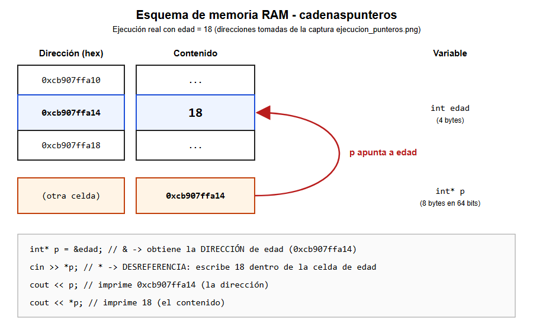
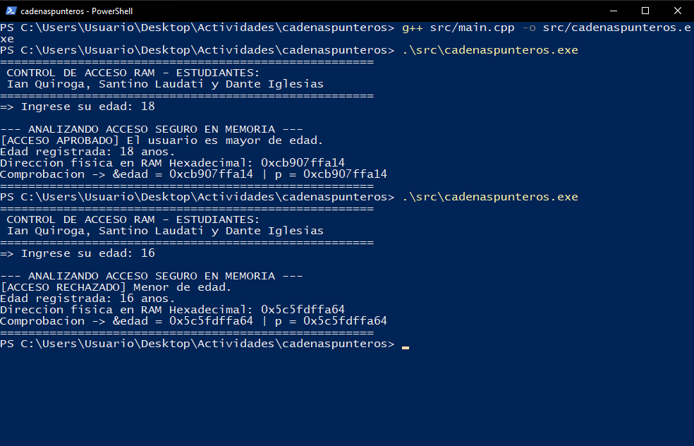

# 1. Propósito del documento

Este manual describe el funcionamiento interno del programa **cadenaspunteros**, un control de acceso por edad que opera sobre la memoria RAM mediante un puntero y desreferenciación. Explica las variables, el modelo de memoria, la compilación y las reglas para trabajar con punteros de forma segura.

# 2. Requisitos

| Herramienta | Versión |
|---|---|
| g++ (MSYS2 UCRT64) | 16.1.0 o superior |
| Visual Studio Code | Con extensión C/C++ |
| Windows | 10/11, 64 bits |

# 3. Estructura del repositorio

```
cadenaspunteros/
├── .gitignore  ├── LICENSE  ├── README.md
├── docs/InformeProyectoCADENASPUNTEROS.pdf
├── docs/manuales/manual_programador_v1.0.0.(md|pdf)
├── src/main.cpp
└── capturas/ejecucion_punteros.png, esquema_ram.png
```

# 4. Modelo de datos y memoria

| Identificador | Tipo | Tamaño (x64) | Contenido |
|---|---|---|---|
| `edad` | `int` | 4 bytes | Edad ingresada por el usuario |
| `p` | `int*` | 8 bytes | Dirección de `edad` (`&edad`) |



# 5. Flujo del programa

1. `int edad = 0;` reserva el casillero e inicializa en 0.
2. `int* p = &edad;` guarda la dirección de `edad` en `p`.
3. `cin >> *p;` escribe la edad ingresada en el casillero apuntado.
4. `if (*p >= 18)` evalúa el contenido apuntado:
   - verdadero → `[ACCESO APROBADO]`
   - falso → `[ACCESO RECHAZADO]`
5. Se imprime la edad (`*p`), la dirección (`p`) y la comprobación `&edad == p`.

# 6. Operadores clave

| Expresión | Significado | Ejemplo de salida |
|---|---|---|
| `&edad` | Dirección de la variable | `0xcb907ffa14` |
| `p` | Dirección guardada en el puntero | `0xcb907ffa14` |
| `*p` | Valor en la dirección apuntada | `18` |

# 7. Compilación y ejecución

```powershell
g++ src/main.cpp -o src/cadenaspunteros.exe
.\src\cadenaspunteros.exe
```



> Las direcciones cambian en cada ejecución porque Windows aplica ASLR (aleatorización del espacio de direcciones). Es un comportamiento normal.

# 8. Buenas prácticas con punteros

- Inicializar siempre un puntero (con una dirección válida o `nullptr`) antes de usarlo.
- Nunca leer con `cin >> p;`: se debe desreferenciar (`cin >> *p;`).
- No devolver punteros a variables locales de una función que ya terminó.
- Antes de desreferenciar un puntero que podría ser nulo, verificar `if (p != nullptr)`.

# 9. Guía de mantenimiento

- Para cambiar la edad mínima, modificar la constante `18` de la condición (se recomienda declararla como `const int EDAD_MINIMA = 18;`).
- Mantener los nombres del grupo en el encabezado de la salida (regla anticopia).
